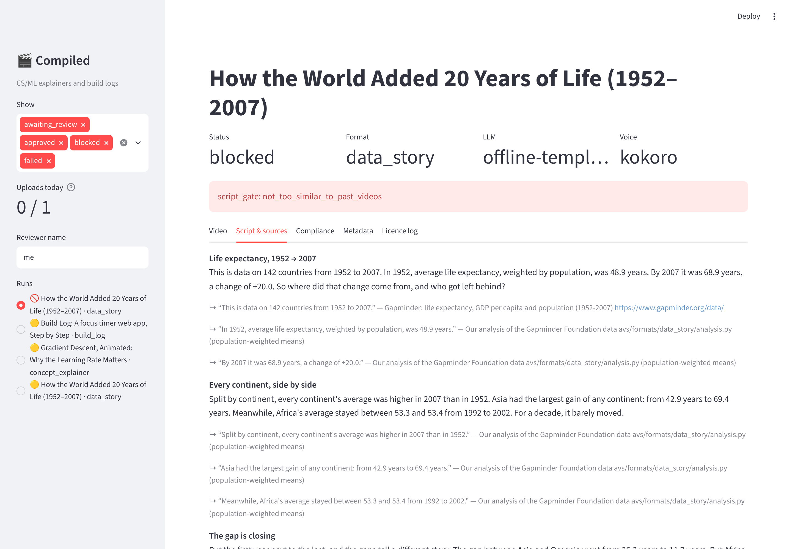

# AI Video Studio

A multi-agent YouTube production engine for the channel **Compiled** (CS/ML explainers and build logs).
Video formats are plugins, every factual sentence must cite a source, and **nothing is uploaded until a
human approves it in the review dashboard**. It runs on a 16 GB laptop with no GPU and needs no paid services.

```bash
avs run --format data_story          # research → script → assets → voice → edit → package → review queue
avs dashboard                        # watch, check the sources, approve or reject
avs publish                          # upload approved videos to YouTube as PRIVATE (daily cap applies)
```

| Sample | Format | Length (16:9 / short) | What it shows |
|---|---|---|---|
| [`samples/data_story/`](samples/data_story) | `data_story` | 2:17 / 0:52 | 142 countries of Gapminder data: who gained life expectancy, who stalled, and what income does and doesn't explain |
| [`samples/concept_explainer/`](samples/concept_explainer) | `concept_explainer` | 1:41 / 0:34 | Gradient descent, animated from a seeded simulation: three learning rates that crawl, converge and diverge |
| [`samples/build_log/`](samples/build_log) | `build_log` | 1:45 / 0:42 | A build agent writes a focus-timer web app in 3 tested commits while Playwright records the screen |
| [`samples/blocked_duplicate/`](samples/blocked_duplicate) | `data_story` | not rendered | The same data_story run again: **blocked at the script gate** by the similarity check (cosine 1.000 ≥ 0.80) |

Each sample folder has the 16:9 video, the 9:16 short, the thumbnail, `metadata.json` (what would be sent to
YouTube), `captions.srt`, `script.json` (every claim with its source), the compliance reports and the licence log.

---



## Architecture

```mermaid
flowchart LR
    CLI["avs run --format X"] --> R

    subgraph Engine["LangGraph production graph"]
        direction LR
        R[Research agent] --> S[Script agent]
        S --> G1{{script_gate}}
        G1 -- "fail + LLM: rewrite with feedback (≤2)" --> S
        G1 -- pass --> A[Asset agent]
        A --> V[Voice agent]
        V --> G2{{pre_render}}
        G2 -- pass --> E[Editor]
        E --> P[Thumbnail + metadata agent]
        P --> G3{{pre_review}}
    end

    G3 -- pass --> Q[(Review queue)]
    G1 & G2 & G3 -- fail --> B[(blocked + report)]
    Q --> D[Streamlit dashboard<br/>human approval]
    D -- approved, content hash pinned --> PUB[Publisher]
    PUB --> G4{{pre_upload<br/>+ approval + daily cap}}
    G4 -- pass --> YT[(YouTube Data API v3<br/>upload as PRIVATE)]

    subgraph Plugins["Format plugins (one folder each)"]
        F1[data_story]
        F2[concept_explainer]
        F3[build_log]
    end
    Plugins -. "research() · template.md · generate_assets() · checks()" .-> Engine

    subgraph LLM["LLM provider (.env)"]
        L1[Gemini free tier · default]
        L2[Claude]
        L3[OpenAI]
        L4[offline template writer]
    end
    LLM -.-> S
```



| Agent | Module | What it does |
|---|---|---|
| Research | `formats/<name>/plugin.py: research()` | Format-specific: loads and analyses a dataset, runs a seeded simulation, or *does the build*. Produces sources, facts (each tied to a source) and a **storyboard** of beats. |
| Script | `formats/base.py: write_script()` | The LLM fills `template.md` with narration for each storyboard beat and must attach a `claims` entry (text + `source_id`) to every factual sentence. With no key it uses the plugin's deterministic template writer. The LLM chooses the words but never the visuals. |
| Asset | `formats/<name>/plugin.py: generate_assets()` | Charts and animations (matplotlib → ffmpeg), screen recordings (Playwright + Chromium screencast). Every asset is logged with its licence and origin. Short-eligible beats also get a native 4:5 render for the vertical cut. |
| Voice | `agents/voice.py` | Kokoro-82M ONNX on CPU (default), Piper, **your own recordings**, or silent. |
| Editor | `agents/editor.py` | ffmpeg filtergraphs: burned-in captions + `.srt`, self-synthesised music bed, crossfades, 16:9 and 9:16. |
| Thumbnail + metadata | `agents/packaging.py` | Thumbnail from the hero frame, description with chapters, every cited source, licence credits and AI disclosure. |
| Review | `dashboard/app.py` | Watch both cuts, read each claim next to its source, see every compliance report, edit metadata, approve/reject. |
| Publisher | `agents/publisher.py` | Resumable upload as `private`, thumbnail, captions; logs the upload for the daily cap. |

**Design choices worth knowing**

- **The plugin owns the visuals and the LLM owns the words.** The storyboard fixes what is shown, and the LLM
  writes narration per beat from that beat's facts. A hallucinating model can't invent a chart, and the claims
  gate catches invented numbers.
- **Everything is a file.** Each run is a folder (`runs/<id>/`) with `research.json`, `script.json`,
  `assets.json`, `compliance/*.json`, `review.json`... Graph state is just ids, so any run can be audited,
  resumed (`avs resume <id> --step edit`) or reviewed later.
- **Rendering happens in ffmpeg, not Python.** A first version composited frames in moviepy and ran about 10× slower
  than real time on CPU. All overlays, crossfades and mixing now happen in ffmpeg filtergraphs: a 2-minute
  1080p video plus its short renders in about 2.5 minutes on 4 cores.

## Compliance layer

Runs at four points; any blocking failure stops the run and writes a report the dashboard shows.

| Check | Stages | Rule |
|---|---|---|
| `claims_have_sources` | all | Each narration sentence that *looks* factual (numbers, dates, rankings, comparisons, "invented/discovered", "every/only/never") must be covered by a claim in that segment that contains all its numbers. Each claim must cite a source that exists and is citable (URL, dataset, book reference or code reference). **Grounding:** every number in a claim must match a number in a fact from the cited source, to the claim's precision, so a real source can't be cited for an invented figure. |
| `not_too_similar_to_past_videos` | script_gate, pre_render | Cosine similarity of embeddings against published history plus every pending/approved run. Local hashed n-gram embeddings by default (no download), Gemini embeddings when configured; each embedder has its own threshold. |
| `no_health_finance_legal_advice` | all | Discussing a domain is fine (life-expectancy data passes). An *advice-intent pattern* together with a *domain term* in the same sentence is blocked, as are advice-request topics ("best stocks to buy…"). With an LLM configured, a second-opinion reviewer can add blocks but never remove them. |
| `asset_licences` | pre_render → | Every asset and dataset needs a licence from the allow-list (`self-generated`, CC0, CC-BY-4.0, public domain, OFL fonts). CC-BY needs attribution text, and that text must appear in the description. Writes `licence_log.json` per run plus a channel-wide `data/state/licence_log.csv`. |
| `synthetic_content_disclosure` | pre_review → | A realistic voice (Kokoro/Piper) or a realistic synthetic person ⇒ `status.containsSyntheticMedia = true` **and** a disclosure line in the description. Your own recorded voice needs neither. |
| `upload_as_private` | pre_review → | Metadata type only allows `private`, and the upload body builder refuses anything else. |
| `human_approval` | pre_upload | Approved **in the dashboard** (`approved_via == "dashboard"`), and the SHA-256 of video + thumbnail + metadata still matches what was approved. Edit anything and you must approve again. |
| `daily_upload_cap` | pre_upload | Uploads per calendar day in `channel.timezone` (Asia/Colombo by default) must stay below `publish.daily_upload_cap`. |
| format checks | pre_render → | `data_story`: every chart shows its source on screen; the dataset snapshot is SHA-256 pinned. `concept_explainer`: the simulation is re-run and must reproduce every cited number. `build_log`: all browser tests pass, no console errors or external requests, no API keys or private keys visible in any file or recorded page. |

Tests: `pytest` (69 tests, ~12 s). They cover each compliance check, including the ways each one can fail, the
publisher's approval, hash and cap gates against a fake YouTube client (with the midnight boundary in Sri Lanka
time), the real Streamlit dashboard driven headlessly (approve → gate opens, edit metadata → approval voided), the LLM rewrite loop (a fake model's uncited first draft is sent back with the gate's feedback and fixed), plugin discovery from an external folder, and full pipeline runs with a throwaway plugin. Those runs
reach the review queue, get blocked at the script gate for an uncited superlative, and get blocked for
health advice.

## Quick start

```bash
git clone <this repo> && cd ai-video-studio
python -m venv .venv && source .venv/bin/activate      # Windows: .venv\Scripts\activate
pip install -e ".[all]"
playwright install chromium                             # for build_log
python scripts/download_models.py                       # Kokoro voice, ~90 MB, Apache-2.0
cp .env.example .env                                    # add GEMINI_API_KEY (free at aistudio.google.com)
avs formats
avs run --format concept_explainer --topic "gradient descent"
avs dashboard
```

Requirements: Python 3.10+, ffmpeg on PATH (or the one bundled with `imageio-ffmpeg`), git.
No GPU. Measured on a 4-core CPU box: a full run takes 6–8 minutes per video (both cuts), and the
pipeline's peak memory, including Chromium during build_log, was 2.7 GB.

### Choosing the LLM

`config/studio.yaml → llm.provider` (or `AVS_LLM_PROVIDER`, or `avs run --llm …`):

| Provider | Key | Default model (override in `.env`) |
|---|---|---|
| `gemini` (default) | `GEMINI_API_KEY`, free tier | `gemini-2.5-flash`, embeddings `text-embedding-004` |
| `claude` | `ANTHROPIC_API_KEY` | `claude-sonnet-5-5` |
| `openai` | `OPENAI_API_KEY` | `gpt-4.1-mini` |
| `offline` | none | deterministic template writer per format |

If a key is missing or a call fails, the engine falls back to `offline` and logs a warning. To make that a hard
failure, set `llm.fallback_to_offline: false`. Free-tier rate limits (HTTP 429) are retried with backoff.

### Voice

- `kokoro` (default): `am_michael` voice, `voice.kokoro_voice` to change (54 voices). Realistic, so the disclosure flag is set.
- `piper`: put a Piper `.onnx` voice at `voice.piper_model`.
- `recorded`: your own voice. Run the pipeline once, then `avs record-sheet <run_id>` prints one line per
  segment. Record each to `recordings/<run_id>/<segment_id>.wav`, then `avs resume <run_id> --step voice --voice recorded`.
  No disclosure flag is needed.
- `silent`: timed silence, for previewing visuals.

### Scheduling

Each command is a plain process with an exit code (0 = queued for review, 2 = blocked/failed), so cron or
Windows Task Scheduler is enough. Times below are SLST (UTC+05:30):

```cron
CRON_TZ=Asia/Colombo
# Mon/Wed/Fri 02:10: produce one video per format into the review queue
10 2 * * 1 cd ~/ai-video-studio && .venv/bin/avs run -f data_story        >> logs/cron.log 2>&1
10 2 * * 3 cd ~/ai-video-studio && .venv/bin/avs run -f concept_explainer  >> logs/cron.log 2>&1
10 2 * * 5 cd ~/ai-video-studio && .venv/bin/avs run -f build_log          >> logs/cron.log 2>&1
# daily 18:40: upload whatever you approved (still private, still capped)
40 18 * * * cd ~/ai-video-studio && .venv/bin/avs publish                  >> logs/cron.log 2>&1
```

## How to add a new format

A format is **one folder** in `src/avs/formats/` (or in any folder listed in `AVS_EXTRA_FORMATS`), discovered
automatically:

```
src/avs/formats/paper_digest/
├── __init__.py      # PLUGIN = PaperDigest()
├── plugin.py        # the class below
├── template.md      # LLM prompt; {topic} {angle} {channel} {storyboard} {facts} {sources} are filled in
└── ...              # anything else it needs: data, recipes, scene code
```

```python
from avs.formats.base import FormatPlugin
from avs.formats.writing import Beat
from avs.media.anim import bullet_card, estimate_seconds, render
from avs.models import Asset, CheckResult, Fact, ResearchPack, Script, Source


class PaperDigest(FormatPlugin):
    name = "paper_digest"
    description = "Summarise one arXiv paper with animated figures."
    default_topic = "2005.11401"

    def research(self, topic, ctx) -> ResearchPack:
        # 1. gather sources and facts; every fact names the source it came from
        src = Source(id="paper", title="...", kind="web", url=f"https://arxiv.org/abs/{topic}")
        facts = [Fact(id="claim1", source_id="paper", text="The model scored 44.5 on ...")]
        # 2. a storyboard: what is SHOWN in each beat, and which facts it may use
        storyboard = [{"id": "hook", "in_short": True, "facts": ["claim1"],
                       "visual": {"kind": "bullet_card", "params": {"title": "...", "lines": ["..."]}}}]
        return ResearchPack(format=self.name, topic=topic, sources=[src], facts=facts,
                            data={"storyboard": storyboard})

    def fallback_script(self, research, ctx) -> Script:
        # used with no LLM; Beat.say(text, source_id) writes the sentence and its claim together
        b = Beat(research.data["storyboard"][0])
        b.say("The model scored 44.5 on ...", "paper").say("Here's how it works.")
        return Script(format=self.name, topic=research.topic, title="...", thumbnail_text="...",
                      segments=[b.segment()])

    def generate_assets(self, script, research, ctx) -> list[Asset]:
        out = []
        for seg in script.segments:
            path = ctx.assets_dir / f"{seg.id}.mp4"
            render(bullet_card(seg.visual.params), path, estimate_seconds(seg.narration))
            out.append(Asset(id=seg.id, segment_id=seg.id, kind="animation", licence="self-generated",
                             path=str(path.relative_to(ctx.run.path)), origin="matplotlib card"))
        return out

    def checks(self):  # optional: format-specific compliance checks
        return [lambda ctx: CheckResult(check="paper_digest:has_arxiv_link", passed=True)]
```

Then run `avs formats`, then `avs run -f paper_digest`. The LLM path, compliance gates, voice, editor, thumbnail,
metadata, dashboard and publisher all work without further changes. Tips:

- Matplotlib scenes are `setup(fig) -> update(t)` with `t` in 0..1; see `avs/media/anim.py`. Keep the bottom
  ~22% of the frame clear for captions. If `params["_portrait"]` is true, lay out for a 1080×1350 frame (the
  short's native render).
- Mark an asset `meta={"hero": True}` to use its frame for the thumbnail.
- For numbers you compute yourself, cite a `Source(kind="computation", reference="path/to/code.py")` and
  put the number in a `Fact`. The grounding check then accepts it.

The three built-in formats extend in the same way: add a dataset to `data_story/datasets.yaml` (OWID,
World Bank, Kaggle or a bundled CSV), a concept to `concept_explainer/concepts.yaml` plus its simulation and
storyboard, or a project folder to `build_log/recipes/` (step snapshots plus browser tests).

## YouTube API setup

1. Go to <https://console.cloud.google.com/>, create a project (e.g. `ai-video-studio`).
2. **APIs & Services → Library →** enable **YouTube Data API v3**.
3. **APIs & Services → OAuth consent screen:** choose *External*, fill in the app name and your email, add
   the scopes `youtube.upload` and `youtube.force-ssl` (needed for thumbnails and captions), and add your own
   Google account as a **test user**. Leaving the app in *Testing* is fine for personal use.
4. **Credentials → Create credentials → OAuth client ID →** *Desktop app*. Download the JSON to
   `secrets/client_secret.json` (`secrets/` is git-ignored).
5. `avs youtube-auth` opens a browser once for consent and stores a refresh token at
   `secrets/youtube_token.json`.
6. Check that the channel is verified (YouTube Studio → Settings → Channel → Feature eligibility). Custom
   thumbnails need verification.
7. Approve a video in `avs dashboard`, then run `avs publish --dry-run` (runs every gate without uploading),
   then `avs publish`.

Notes:

- **Quota:** the default quota is 10,000 units a day. `videos.insert` costs about 1,600 units, and thumbnails
  and captions add a few hundred more, so 1–3 uploads a day fits easily.
- **Unverified API projects:** videos uploaded by an API project that hasn't passed Google's audit may be
  locked to private. That's fine here because everything is uploaded private and you publish it in YouTube
  Studio after a final look.
- **Disclosure:** the publisher sends `status.containsSyntheticMedia` from the compliance result. You can
  confirm it in YouTube Studio under *Altered content*.

## Repository layout

```
config/studio.yaml          channel, LLM, voice, render, compliance and publish settings
src/avs/
  pipeline.py               LangGraph graph, resume
  cli.py                    avs command
  llm/                      Gemini / Claude / OpenAI / offline behind one interface
  agents/                   voice, editor, packaging (thumbnail + metadata), publisher
  compliance/               claims, similarity, topics, licences, disclosure, publishing gates
  formats/                  base contract + data_story / concept_explainer / build_log
  media/                    theme, matplotlib→ffmpeg animation, captions/cards, music synth
dashboard/app.py            Streamlit review + approval
data/datasets/              bundled dataset snapshots (Gapminder, CC-BY-4.0)
samples/                    one finished video per format
tests/                      compliance + publisher + engine tests
```

## How the samples were made

- **LLM: offline template writer.** The build environment had no API key, so the scripts come from each
  format's deterministic writer (`fallback_script`). They pass the same gates an LLM script must pass. With
  `GEMINI_API_KEY` set, the same command has Gemini write the narration from the same storyboard and facts.
- **data_story** used the bundled Gapminder snapshot (CC-BY-4.0, SHA-256 pinned in the run). The live OWID and
  World Bank loaders are implemented with an on-disk cache, but those hosts were unreachable from the build
  sandbox, so they are untested against the live APIs.
- **Kokoro** model files were taken from a byte-identical npm mirror because GitHub release downloads were
  blocked in the sandbox (the SHA-256 matched the mirror's published hash). Use `scripts/download_models.py`,
  which fetches the official kokoro-onnx release, on your machine.
- **build_log** replayed the recipe's reference implementation (no LLM). With an LLM, each step is written by
  the model, must pass the same browser tests, gets one repair attempt, and otherwise falls back to the
  reference. The build log records which happened for each step.
- **Publisher:** tested against a fake YouTube client. No real upload was made from the build environment.

## Licence

Code: MIT. Bundled Gapminder data: CC-BY-4.0, Gapminder Foundation. Kokoro-82M: Apache-2.0.
Inter font: SIL OFL 1.1.
